# How Death Muffin makes 3D models: a review packet

Written 2026-11-06 by Claude (the AI that builds Death Muffin) at Helix's request, for an outside reviewer. It covers the whole 3D asset
workflow: how a model is made today, how we got here, where it stands, and what is wrong with it. Unlike the rest of the docs it keeps
the history on purpose, because the history is what is being reviewed. The working how-to is [ASSET_PIPELINE.md](../../ASSET_PIPELINE.md);
when the two disagree, that file and the code win.

Pictures are inline. Videos are short mp4 files in [media/](media/) (open or download them from GitHub). Every claim of quality below was
judged by the team looking at the model in the game or in a model viewer, not only by numbers.

## Contents

1. [What we want from the reviewer](#1-what-we-want-from-the-reviewer)
2. [The setting: game, team, hardware, money, budgets](#2-the-setting)
3. [The pipeline today](#3-the-pipeline-today)
4. [History, step by step](#4-history)
5. [Where it stands on 2026-11-06](#5-where-it-stands-on-2026-11-06)
6. [Problems and risks](#6-problems-and-risks)
7. [Options and Claude's read](#7-options-and-claudes-read)
8. [Where to look](#8-where-to-look)
9. [All pictures and videos](#9-all-pictures-and-videos)

## 1. What we want from the reviewer

Please challenge the direction, not just the details. The questions we most want answered:

1. **Direction.** Is "free open image-to-3D (Pixal3D) on our own graphics card, then automated Blender clean-up, rigging and animation" the
   right foundation for a small team with no 3D artist, given the quality bar below? Or should characters come from a paid generator
   (Tripo), a licensed modular kit, or a human artist?
2. **Characters.** Hero and player bodies are where we are stuck (section 4.5 to 4.7). Which path is most likely to reach "looks as good
   as Tripo or better, moves like the current heroes": the character factory (Pixal body + close-up parts), MakeHuman base bodies with
   gear as separate pieces, or re-skinning new meshes onto the Tripo skeleton we already animate?
3. **The quality gap.** Is our diagnosis right (section 6.1)? The team's own words: "our pixal models look low quality compared to the
   tripo models", "everything looks the same dull flat look, no definition between metal, cloth, leather". What would you change first?
4. **Process.** Since Tripo was paused on 2026-10-26, eleven days of work have not produced a character body the team accepts. What would you do
   differently in how the work is tested, reviewed and decided?
5. **Blind spots.** Tools, models or techniques we have not considered (open-source preferred; licences must allow a commercial game),
   and any licence or technical risk we have missed.

## 2. The setting

**The game.** Death Muffin is an online co-op action RPG about necromancers (four playable disciplines plus the Reaper). Godot 4.7.2,
Forward+ renderer, a C++ combat core. The camera looks down at about three-quarters from roughly 22 m away ([docs/LOOK.md](../LOOK.md)),
so most models are seen small. The biggest benchmark fight holds about 72 enemies, 32 thralls and a boss at once, so crowd models are
budgeted hard.

**The team.** Three people decide: the owner (brbmuffins), Helix and warbogar. **Nobody on the team writes code or models by hand.** Claude
builds everything and the team approves by looking at pictures, videos, model files and the game. A Discord bot (the "Discord agent",
also Claude) can make models for the team on request inside a sandbox.

**Hardware.**
- The server (a VPS) has no graphics card: Blender, the bakes, rigging and any CPU model steps run there, at low priority, beside live
  game servers.
- Helix's PC (RTX 4070 SUPER, 12 GB) is the only PC that can run the image-to-3D models. A small team app on it takes jobs from the
  server (DECISIONS B54, B55, B76).
- The owner's PC (RX 6600, 8 GB) renders in-game views of models (B75).
- Helix ruled out renting cloud GPUs on 2026-11-03.

**Money.** The goal is near-free production that lasts years ("we take time now to build the right tooling to do things inexpensively in
the long run", Helix 2026-10-26). Time is not counted as a cost; money and the team's review time are.
- Tripo (paid API): ~$161 (16,070 credits) spent 2026-09-26 to 10-15; 191 model specs on record. **Spending paused by Helix on 2026-10-26** and still paused.
- Gemini pictures: ~$0.07 to $0.15 each. About $3 spent on pictures for this work since 10-26; the character factory had a $10 build budget
  ($2.07 used).
- Pixal3D runs and all Blender work: $0.

**Budgets** (DECISIONS B71; CI enforces them with `tools/assets/check-models.mjs`, and crowd creatures with the crowd bake):

| Kind | Triangles | Texture |
|---|---|---|
| Crowd creatures | at most 5,000 (Bone Colossus 6,000) | 1024 with levels of detail |
| Hero, bosses | at most 20,000 (hero target 12,000) | up to 2048 (heroes ship 1024) |
| Props / buildings / gear | caps 6,000 / 10,000 / 4,000 | |

One material per model. Every hero body uses the shared Tripo biped skeleton (59 joints, no fingers, A-pose rest) and its 23 clips.

**The look** (B81, [docs/LOOK.md](../LOOK.md), approved 2026-11-01): grimy painted realism; world materials in natural colours with mood
from light; male and female bodies for every class, with classes told apart by their outfit and gear, made once and wearable by anyone.
The quality reference is the current Tripo-made heroes. The target Claude set out on 2026-10-30 (not confirmed by the team): a polished
small-studio ARPG, not Diablo IV.

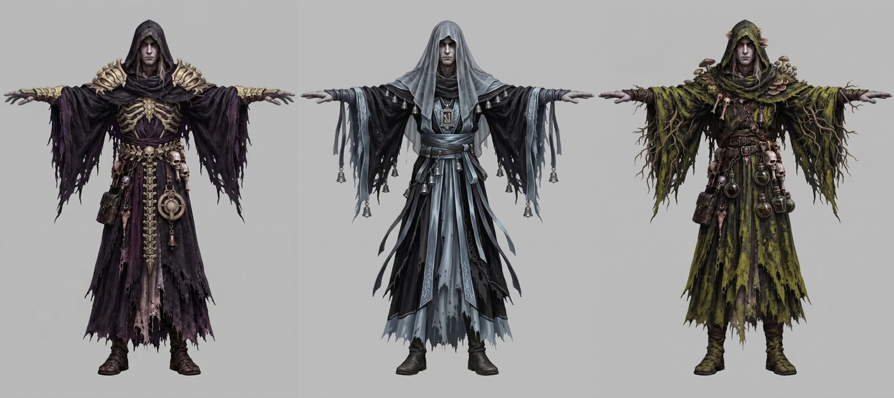

## 3. The pipeline today

This poster (2026-10-28) is the pipeline as the team saw it after the first Pixal model shipped:

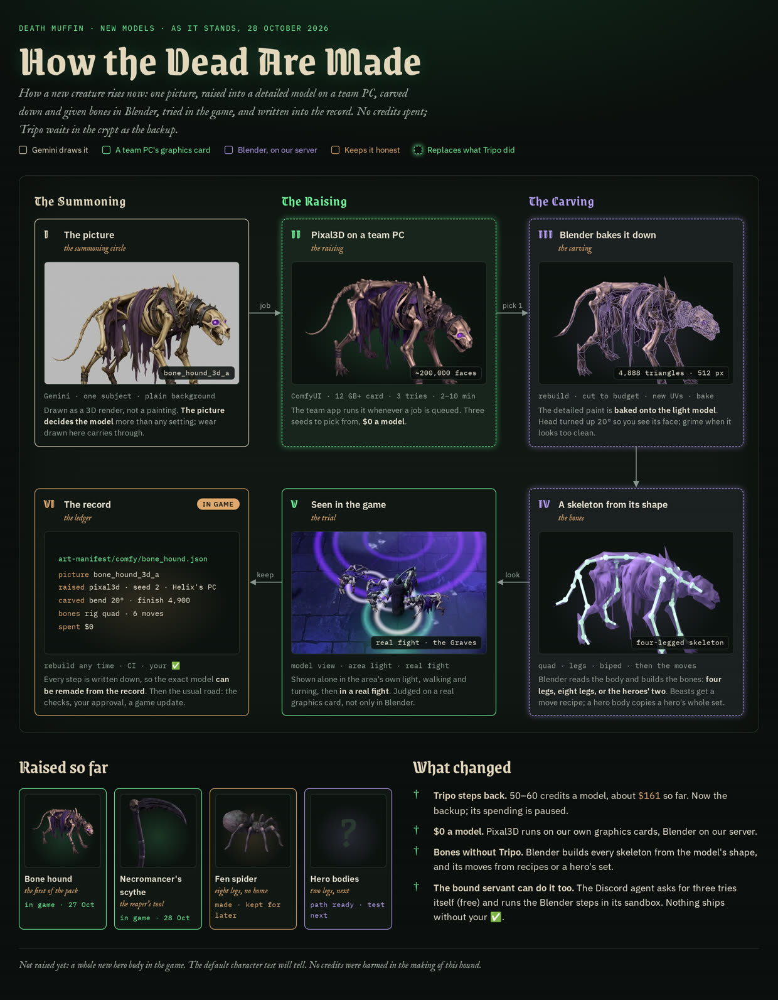

### 3.1 A creature or prop (proven, in the game)

1. **Picture.** A Gemini 3.1 Flash Image picture made from the existing concept art as a "3D render" of the subject: one subject on
   plain light grey, flat light, solid shapes big enough to model, dirt and wear painted into the colours, three-quarter view from a
   little above (`tools/ai/gemini.mjs`, jobs in `art-manifest/gemini-jobs/concepts.json`). Pixal copies the picture literally, so the
   picture decides the model more than any setting.
2. **Detailed model on Helix's PC.** `server/death-muffin/model-gen.sh` queues a job; the team app runs ComfyUI's built-in "Pixal3D &
   TRELLIS.2: Image to Model" template (`teamapp/comfy/image-to-model.json`). Settings used for everything so far: 200,000 faces, texture
   2048, `detail` 2048, `grid` 1024, three seeds to pick from. 2 to 10 minutes a run, free. Pixal3D (MIT) makes the shape and paint;
   it makes no skeleton.
3. **Blender steps on the server**, listed in the model's record `art-manifest/comfy/<id>.json` and run by `tools/blender/make.mjs`
   (step kinds in `tools/blender/comfy/kinds.json`):
   - `fit`: stand the model up, scale it, face it, or fit it onto the old model it replaces.
   - `bend`: turn a part about a joint (the hound's head, raised 20° so the camera sees its face).
   - `finish`: the game mesh. A new low mesh at the budget (a voxel "solid" rebuild, or `meshopt` straight on the detailed mesh), new
     UVs packed with xatlas, and the detailed model's colour, roughness, metal and normals baked onto it with our own ray baker.
   - `materials`, `grime`, `place`.
   - `rig`: a skeleton built from the model's shape: `quad` (four legs), `legs` (any number, the fen spider), `biped` (the heroes'
     skeleton fitted to a new body).
4. **Moves.** A four- or many-legged model gets its clips from a Blender motion recipe (`tools/blender/recipes/bone_hound.json`); a
   biped copies all 23 hero clips by retargeting from `hero_gravecaller` (Blender jobs, `tools/blender/jobs.mjs`, DECISIONS B74).
5. **Build and check.** `tools/build-characters.mjs` and `server/death-muffin/discord-agent/build-art.sh` write the game file; the model
   check runs in CI.
6. **Look in the game.** `server/death-muffin/model-view.sh` shows the model in the area's own light on a team PC, walking, turning and
   playing its clips (B75), then in a real fight.
7. **Ship.** The team approves, CI passes, the client is published. The record lets anyone remake the exact model from the same run.

The Discord agent can do steps 1 to 5 itself for free (`.dm-model-request.json` asks for three tries;
`server/death-muffin/discord-agent/make-model.sh` runs the Blender steps in its sandbox, B77).

### 3.2 A hero (the "character factory", built 2026-11-03/04, not yet accepted)

Pixal3D reads a whole figure at 512 and 1024 pixels, so a face or a skull on a shoulder plate is about 25 pixels of input and comes out as
a lump. The factory works around that (ASSET_PIPELINE.md "A character's detail"):

1. The body from the concept alone (front views plus a generated back view made the body worse on all five seeds).
2. Gemini close-ups of the small parts at 2K (head, shoulder plate, gorget, ribcage, pendant), each made into its own detailed model.
3. Each part placed by a box measured on the concept, armour marked `rigid`.
4. Material labels from the concept: `tools/assets/matmap/` (SAM 2.1 cuts regions, SigLIP 2 names each region's material, YuNet keeps
   the face skin), projected onto the model to give cloth, leather, metal and bone their own roughness and shine.
5. `finish` with `meshopt` at 20,000 triangles, then the `biped` rig with joints placed from the body's filled shape (within 0.01 of
   the height of the four Tripo heroes' own joints) and robe weights spread across both legs.

### 3.3 Default bodies (MakeHuman, outside the repo, waiting for an OK)

The current direction for player bodies (B81: two bodies, gear as pieces). A MakeHuman/MPFB2 body (CC0 assets) is fitted to a concept's
outline and face landmarks (MediaPipe), painted from the concept, given plain underclothes, rigged, cut to about 10,000 triangles, and
given the current heroes' clips by retargeting that matches each hand's world orientation to the hero's. Scripts are in
`~/.cache/dm-ops/human/` on the server, not in the repo yet.

### 3.4 Tripo (the backup, paused)

`tools/ai/tripo.mjs` with specs in `art-manifest/tripo-specs/`. Image to model 50 to 60 credits, rig 25, retarget 10 a clip; a rigged
7-clip hero about 155 credits (~$1.55). All Tripo bipeds share one joint set, which is why every current hero can play every hero clip.

## 4. History

### 4.1 Tripo era (2026-09-26 to 10-15)

All models came from Gemini concepts through Tripo: 191 specs, 16,070 credits (~$161), about 80% of them in today's game. The Discord
agent got a full armour-set pipeline on 2026-10-12 (concepts, one approval, Tripo models, render sheet, in-game shots). Lessons kept in
ASSET_PIPELINE.md: Tripo's `hurt` preset is a 14 s lying clip, the avian rig bones one wing, Tripo materials come out metallic and white
out under bloom. Owner rule from 2026-10-05: reuse existing assets first, generate only when nothing usable exists.

### 4.2 Blender takes over motion and edits (2026-10-25)

- **B74:** edits and new moves on shipped models are recorded Blender jobs (`tools/blender/kinds.json`: motion recipes, library moves,
  retarget, recolour, decimate, reshape, cloak), merged back by bone name. Tripo only for new models.
- **B75:** a model is judged in the game on a team PC, not only in Blender stills.
- A Blender-only modelling test (no generator): the brazier came out near Tripo's; the bone hound looked toy-like. Projecting concept art
  onto a hand-built shape failed because the shape did not match the drawing. Verdict: creatures and heroes need a generator.

### 4.3 Pixal3D replaces Tripo for new models (2026-10-26 to 10-28)

- **10-26:** Helix paused Tripo spending and asked for ComfyUI on Helix's PC. Team app 0.5.0 to 0.5.6 (one day) added the `model` job,
  shape settings, a camera-angle setting, multi-view runs and a low-memory mode (B76).
- **Overnight bake-off** (47 models, 2 hours, $0): creatures 16 of 16 as good as Tripo or better; props 6 of 9 first try;
  buildings rough; TRELLIS.2 worse (darker, hard surfaces fall apart). About 1 in 3 Pixal models marked whole stone or bone parts as metal
  (near-black in game).
- **Helix:** "don't keep a broken system and try to make it work ... start fresh and do things right with the tools we have like pixal3d and
  blender." Four rounds followed the same day:
  1. *Game meshes:* Pixal's own cut-down was crude. Our `finish` (voxel solid rebuild for Pixal's paper-thin double walls, our own ray
     baker because Blender's bake hit neighbouring parts, region-grown UV charts, xatlas packing) matched Tripo's triangle counts and
     measured as good or better on 7 of 8 subjects.
  2. *Skeletons from the shape:* joints found along the body's depth ridge so robes and capes don't pull them; geodesic voxel skin
     binding instead of Blender's bone heat; a four-legged skeleton built from nothing.

     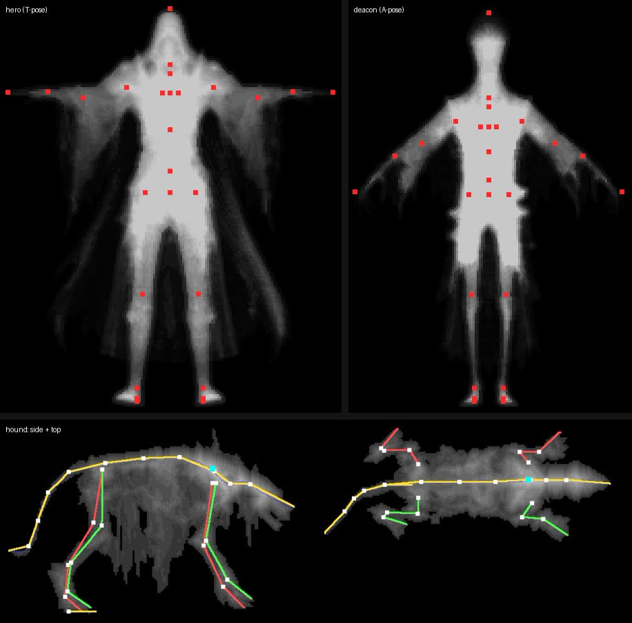
  3. *Animations:* a remake keeps its own live clips; new monster moves from Blender recipes. The live bone hound, cinderhound and skull rat
     got a new bite, flinch and death (shipped 10-26, `55c55525`).
  4. *Gear prototype:* bodies cut into helm, shoulders, chest, gloves, legs and boots regions; a region from one character fitted onto
     another ([video](media/v3-gear-regions-mixed-walk-2026-10-26.mp4)).

     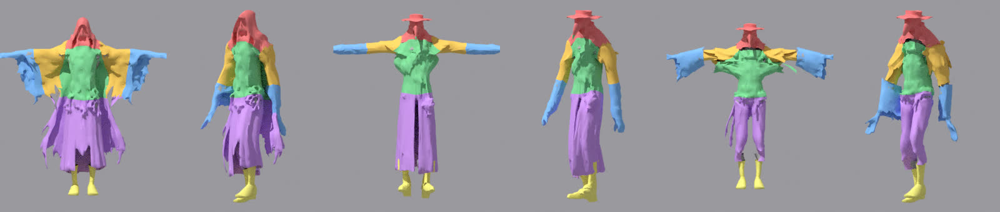
- **Tuning Pixal itself** (16 runs): no setting closed the gap; the settings act after Pixal has decided the shape. **The picture mattered
  more than any setting:** a clean "3D render" picture of the hound beat the painted concept clearly. Extra views (front, left, back)
  gave clean legs but a pale, muddy body. `detail` 2048 was the one real gain; higher grids ran out of memory on the 12 GB card.
- **Honest comparison at Tripo's own budgets** (10-26): statue Pixal better; hero about equal; gargoyle and tree even; mausoleum and helm
  mixed; hound crisper from Tripo at 256 px textures; fence better from Tripo (thin bars melt).

  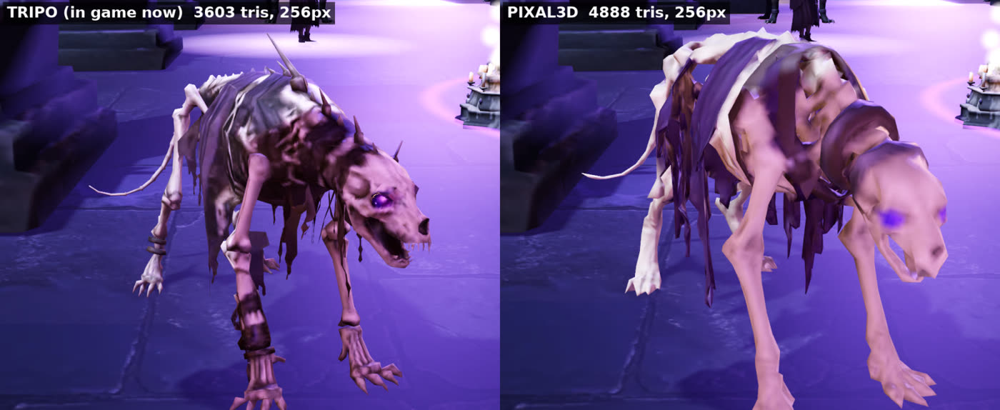
- **Grime:** the clean hound picture made a clean model that Helix called a "Halloween decoration". Rule since: pictures for Pixal keep
  dirt, stains and wear painted in. A Blender grime pass exists but a grimy picture worked better.
- **10-27, the first Pixal model ships:** the bone hound from new picture A, seed 2, head raised 20° so its open jaw faces the camera like
  Tripo's, 4,887 triangles, 512 px texture, our four-legged skeleton, six moves (`f52d8893`). CI caught that crowds drew it white (the crowd
  baker found textures by Tripo's file names); fixed before release.

  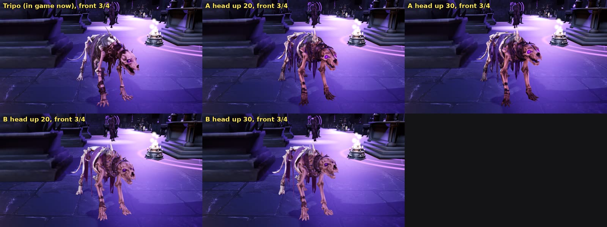
  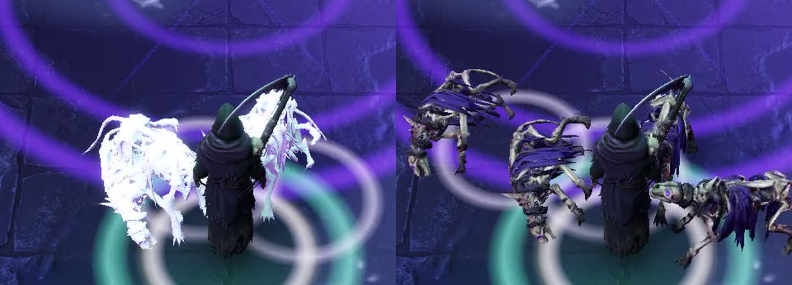

  Videos: [the hound's six moves](media/v1-hound-pixal-six-moves-2026-10-27.mp4), [in a real fight](media/v2-hound-pixal-real-fight-2026-10-27.mp4).
- **B77 (10-27):** new models come from Pixal3D and Blender; Tripo is the backup. Tests the same day: an eight-legged fen spider (built,
  six clips, kept on record, not in game) and the necromancer's scythe (in game 10-28, `920f9917`).
- **Mausoleum:** a Pixal remake from a new picture was better in places, but Pixal guessed the unseen back roof wrong on every one of 7
  seeds. Helix: "just skip replacing the mausoleum" (10-28). Kept as tag `archive/mausoleum-b`.

  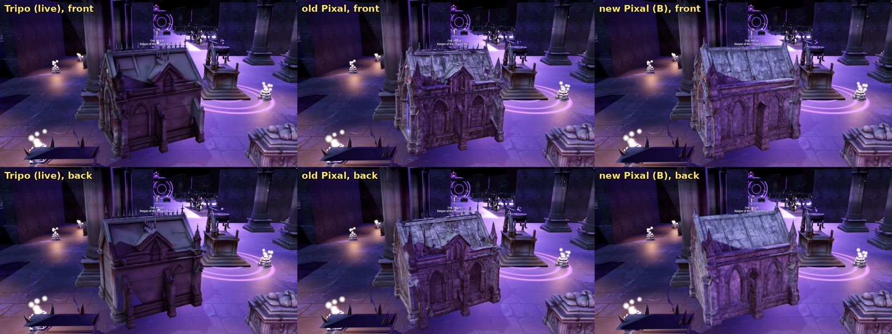
- **Two-legged bodies (10-27/28):** the `biped` rig and a retarget of all 23 hero clips (`2bea6805`). The first test body walked backwards
  with knees bending the wrong way, and the model viewer showed hero attacks sunk into the floor; three bugs, fixed in `ddb44797`
  ([fixed walk](media/v4-pixal-biped-walk-2026-10-28.mp4)). Helix caught the first two from the videos, not our checks.
- **10-30:** a gear plan and an honest quality read went to the team: fight view good, close-ups below high-end (soft Pixal paint, wobbly
  thin shapes, no chains, fur or cloth simulation, refits stretch details).

### 4.4 Default bodies, first two tries (2026-11-01 to 11-02)

The look (B81) asked for male and female bodies for every class.
- **Pixal bodies** (11-01): rejected. Helix: "that looks like shit" and "the whole model looks bad and the way the hands and arms move is
  all fucked up" (flat bare skin, mitten hands, the hero's robe moves on bare limbs).

  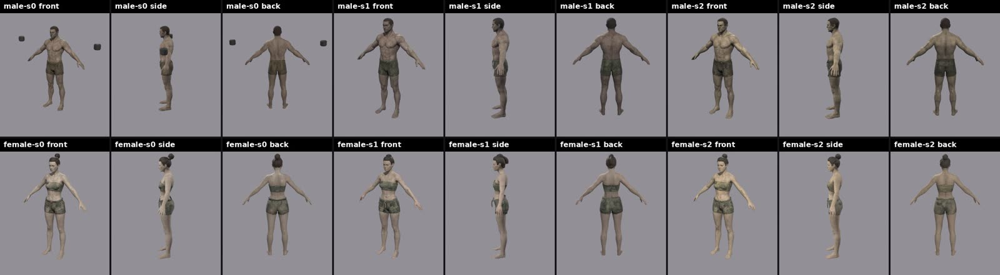
- **MakeHuman (MPFB2) bodies with Quaternius UAL clips** (CC0): movement fixed, but plain and young-looking, and the clips were not ours.
  Rejected 11-02: "the models look bad and the animations are shit too. i liked the old animations." The "old animations" are the current
  Tripo heroes' own clips; they only look right on a body skinned to that skeleton.

  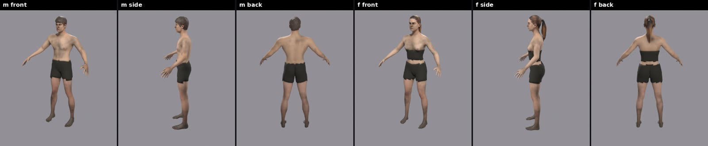

### 4.5 Re-evaluation and the quality gap (2026-11-02 to 11-03)

Helix asked for "a full re-evaluation on how we are making models and assets ... free or very close to free ... high quality models and
textures", research and samples only.
- **Research** (licences checked 11-02): Pixal3D MIT; TRELLIS.2 MIT (its DINOv3 encoder has its own licence); Hunyuan3D 2.1 Tencent
  community licence (commercial outside the EU, UK and South Korea), its paint stage needs ~21 GB; UniRig and SkinTokens MIT; Qwen-Image
  non-commercial (ruled out); cloud 24 GB cards ~$0.34 to $0.69 an hour (later ruled out).
- **T1:** SkinTokens (MIT, run on the server's CPU) skinned a new Pixal Gravecaller onto the *Tripo* skeleton: it played the old clips with
  the cape swinging. Our own rig had no cloak bones, part of why the default bodies moved badly.
- **T2:** projecting the concept's real pixels onto the model ("real paint") was a clear win on the face, skull pauldrons and robe colour.

  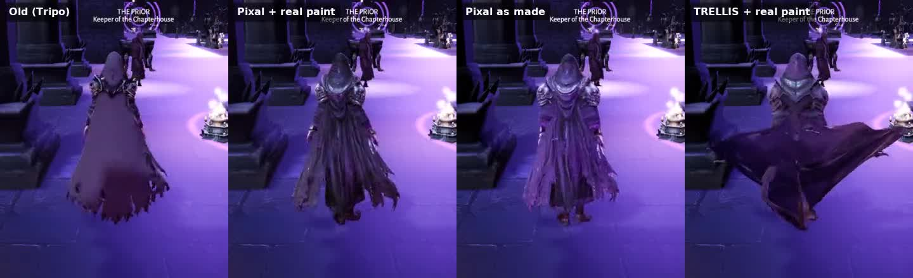

  Video: [walk, Tripo against the new versions](media/v5-gravecaller-tripo-vs-pixal-walk-2026-11-03.mp4).
- **Helix (11-03):** "my main complaint is that our pixel models look low quality compared to the tripo models." Measured: the same
  budget and equal paint sharpness, but our cut-down (solid rebuild plus smoothing) softened folds to half Tripo's crispness and turned thin
  cloth into thick shells. A plain edge-collapse cut at 20,000 triangles matched Tripo's crispness.
- **Helix:** "it seems like fundamentally Tripo is just better in how it creates models and paints them. i want to recreate that or even
  improve apon it." Tripo makes a detailed shape, then a native low-poly mesh and its own PBR paint; open counterparts were listed (TripoSG,
  MV-Adapter, DeepMesh, Hunyuan3D 2.0).
- **Helix, comparing files:** "lacking detail and texture, everything looks the same dull flat look, no definition between metal, cloth,
  leather", "need to add more effort to the face", "i also like tripo's version of hair". Measured: our roughness was one flat 0.88 and
  metal 0 everywhere against Tripo's 0.33 to 0.98 and metal up to 0.37; our occlusion channel was very dark.
- **Shoulder skulls:** Helix: "pixal model needs better detailing like the skulls on the shoulders." Clay renders showed Tripo's skulls are
  *painted* on flat glossy plates; Pixal had made a melted lump. (Claude first said Pixal had modelled the skulls; Helix: "dude LOOK at the
  shoulders... those dont even look like skulls". Helix was right.) Cause: the skull is about 23 px of Pixal's 512 px input. A bigger concept
  does not help, because the template crops and resizes to 1024 and the encoder runs at fixed sizes.

  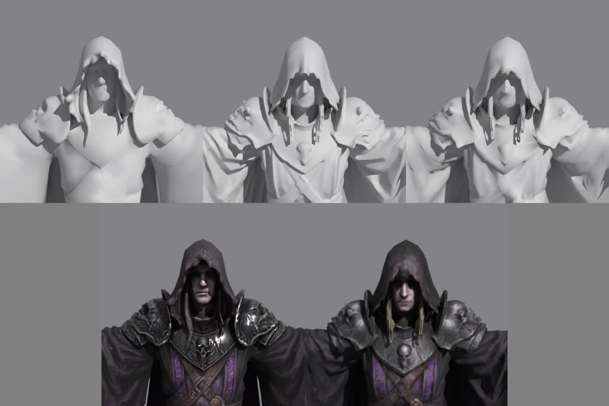
- **Helix:** "we have been working on this system for a long time and its growing old. I really need you to take charge here and build out
  a full system that will give me the desired outcome." Rules set: $10 Gemini while building, tools go to main through CI, anything players
  see waits for Helix's OK on still model files, installs on Helix's PC allowed, no renting, Tripo still paused.

### 4.6 The character factory (2026-11-03 to 11-04)

Built overnight and merged (`a4184e53`, `6e5f2a80`, `8bb22b8c`, `53a2b999`; CI passed). What it does is in section 3.2. Methods tried and
dropped: Blender collapse (folded the face into spikes), picture registration by correlation, DeepMesh (artist-style meshes; ported to CPU
and rejected), a per-class colour match (darkened faces), front plus back views for the body.

All four heroes were remade and sent as still model files on 11-04, beside the Tripo originals. Helix answered: "completely broken where
the head meets the body." The head joint was redone the same day (the body keeps its hood; the close-up head shows only where the
concept's face skin is). Not re-sent as a set; not in the game.

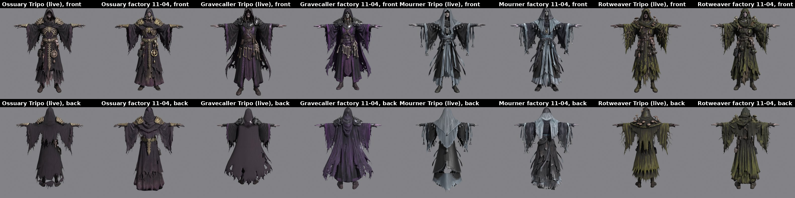
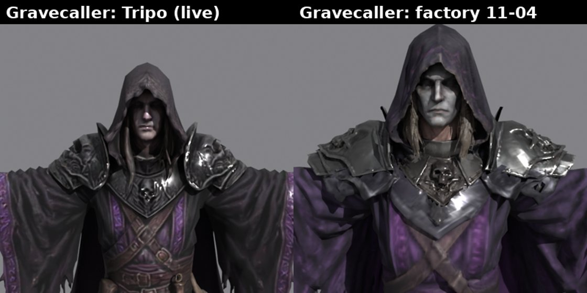

Known limits written down (KNOWN-GAPS.md "Content pipelines"): a one-sheet cloak stretches over the chest when an arm swings across
(13-16% of the surface stretched over 3x at the swing's peak, against Tripo's 1-2%); a long robe still flares in a deep lunge; Pixal shifts
some colours off the concept (charcoal comes out purple).

### 4.7 Default bodies, third try: MakeHuman fitted to the concept (2026-11-04)

Following B81 (two bodies, gear as item pieces), the MakeHuman route came back with three differences from 11-02: the body is fitted to
the concept's outline and face, painted from the concept, and plays the *current heroes'* clips. Sent to Helix on 11-04 with a moves video.
Helix then: "look how long the arms are and the wrists are all crooked." Cause: MakeHuman's rest pose bends each elbow ~45°, so the fit read
the forearm short and stretched it; the clip copy carried hand turns in the wrong frame. Fixed in the scripts the same evening (hands now
within 3° of the hero's direction).

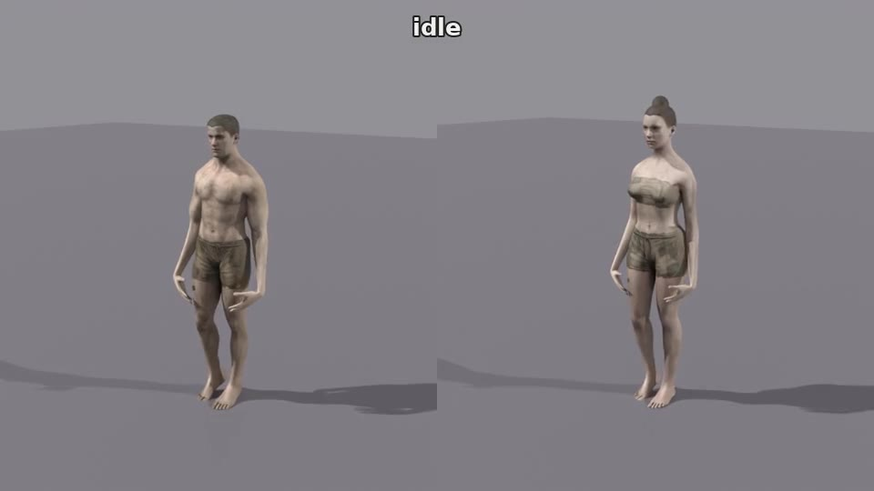

Video: [both bodies playing the heroes' moves](media/v6-makehuman-default-bodies-moves-2026-11-04.mp4) (sent before the arm and wrist fix).

## 5. Where it stands on 2026-11-06

**In the game:** every hero, nearly every enemy and prop are Tripo models (with Blender-made moves on some). Two Pixal models are live:
the bone hound (2026-10-27) and the necromancer's scythe (2026-10-28).

**Made, not in the game:**

| What | Where | State |
|---|---|---|
| Fen spider (8 legs, 6 clips) | `art-manifest/comfy/fen_spider.json` | kept for later |
| Mausoleum remake | tag `archive/mausoleum-b` | dropped by Helix |
| Pixal default bodies (11-01) | worktree `wt/default-bodies`, uncommitted | rejected |
| Four factory heroes (11-04) | session scratch on the server | head join redone after Helix's note; not accepted |
| MakeHuman default bodies (11-04) | `~/.cache/dm-ops/human/` | waiting for Helix's OK |

**Waiting on the team:**
- OK (or not) on the MakeHuman default bodies; on an OK the scripts move into the repo with tests and docs, then the swap.
- Body builds: one build, one per class, or 2-3 builds (slim, standard, heavy; Claude's pick).
- A "prove it" test: a default body with one full gear set on two builds, in game far and close.
- Whether the four heroes are remade at all, and whether the Tripo pause stays.
- A paid 3D artist or a licensed modular kit for base bodies and flagship sets, only if the above falls short.

**Spend so far:** Tripo ~$161 (all before 10-16), Gemini ~$3 since 10-26, everything else $0.

## 6. Problems and risks

### 6.1 Quality

- **Small details:** Pixal sees a whole figure at 512/1024 px, so faces, skulls, buckles and trims come out as lumps. Close-up parts work
  around it but add joins that can break (the head join).
- **Paint:** softer than Tripo's; materials read alike (one roughness, wrong metal). Pixal's metal map is close to one value per model,
  so metal comes from labels or hand rules. Colours drift (charcoal to purple). In game, the area's purple light decides most of the hue,
  so Blender stills and the game disagree.
- **Unseen sides are guesses:** backs come out plain or wrong (the mausoleum's back roof on all 7 seeds); multi-view input made bodies worse.
- **Shape:** Pixal builds thin cloth as paper-thin double walls; capes and tatters become closed shells; thin bars and spikes wobble and
  melt at game budgets (the fence).
- **Characters in motion:** skeletons built from the shape have no cloak or cape bones; one-sheet cloaks and long robes stretch;
  bare skin and hands are weak in every generator we tried; clip transfer to a non-Tripo skeleton needed hand and wrist fixes and still
  loses the root turn in one clip.
- **The reference keeps moving:** Tripo's heroes are the bar. They are good because Tripo makes a native low-poly mesh with crisp folds
  and paints small details instead of modelling them; our path models then bakes down.

### 6.2 Process

- **The ask-and-test loop** cost the team's review time: many rounds of pictures, videos and "Decide" questions before Helix asked Claude to
  take charge (11-03). The factory and the third body try came after that, but the team still found the head join and the arm length.
- **Claude's own errors** reached Helix several times (each logged in the server's mistakes log): the first biped walked backwards; a viewer
  bug was explained as a move; Pixal was said to have modelled the shoulder skulls; "give the head more triangles" (it was the camera
  angle); one comparison showed one character's moves on all four. The common cause: checking a number instead of looking closely.
- **Tools outside the repo:** the research tools (`~/.cache/dm-ops/pixal3d-tests/`, `rigtest/`, `pixelmatch/`, `human/`) and the factory's
  hero records live on the server, some only in a session's temporary folder that a reboot clears. Only part of the pipeline is
  reproducible from git.
- **One GPU, 12 GB:** everything depends on Helix's PC being on. `detail` 2048 runs out of memory about 1 in 4 times at the texture stage;
  heavy runs take 9-10 minutes.
- **Checks that missed real failures:** the model view loads models through a different path than crowds (the white hound); `model-view.sh`
  does not check a plan before queueing it; the Blender tools fail on Blender 5.x (KNOWN-GAPS.md); long jobs on the server die when a
  session restarts.

### 6.3 Licences

Pixal3D and TRELLIS.2 are MIT (the DINOv3 encoder has Meta's own licence, which allows commercial use). The factory's label models
(SAM 2.1, SigLIP 2, YuNet) and MediaPipe are open-source licences that allow commercial use; MakeHuman/MPFB2 assets are CC0; Quaternius
clips CC0 (`docs/licenses/`). Gemini output terms apply to the pictures. Ruled out: Qwen-Image (non-commercial), NVIDIA SeqTex
(non-commercial); Hunyuan3D has regional limits.

## 7. Options and Claude's read

| Option | For | Against |
|---|---|---|
| A. Keep going: MakeHuman bodies + gear pieces, factory for unique heroes | free; fits B81; plays the old clips | two rejections already; bare skin and hands weak; gear pieces not built yet |
| B. New meshes skinned onto the Tripo skeleton (SkinTokens, T1) | keeps every current clip and cloak bone | still needs a good mesh from somewhere; CPU runs ~10 min |
| C. Lift the Tripo pause for character bodies only | the quality bar *is* Tripo; ~$1-2 per rigged hero, clips copy for free | paid per model; not the "free" goal |
| D. Licensed modular character kit or a paid artist for base bodies and flagship sets | professional bodies, hands and faces | money; style match; someone must still dress them |
| E. Other open generators (Hunyuan3D 2.x paint, TripoSG, MV-Adapter) | possibly better paint and shape | Hunyuan's paint needs ~21 GB; untested here |

**Claude's read (for the reviewer to test, not decided by the team):** Pixal3D plus Blender has earned its place for creatures, weapons
and simple props: free, recorded, reproducible and good at game distance. For characters, the work since 2026-10-27 has not produced a body
the team accepts, and the bar is a model that costs about $1-2 from Tripo. The cheapest route to the bar is probably C for bodies (or A if
Helix accepts the MakeHuman bodies), keeping the free path for everything else, rather than more rounds on the character factory. Money and
the Tripo pause are the owner's and Helix's call.

## 8. Where to look

**In the repo:**
- How-to: [ASSET_PIPELINE.md](../../ASSET_PIPELINE.md) ("Image to model", "A character's detail"), [docs/BLENDER-PIPELINE.md](../BLENDER-PIPELINE.md),
  [docs/LOOK.md](../LOOK.md).
- Decisions: [DECISIONS.md](../../DECISIONS.md) B71 (budgets), B74 to B77 (Blender, model view, ComfyUI, Pixal), B81 (the look).
- Gaps: [KNOWN-GAPS.md](../../KNOWN-GAPS.md) "Content pipelines".
- Code: `tools/blender/make.mjs` and `tools/blender/comfy/` (fit, finish, parts, materials, rigs: `finish.py`, `transfer.py`, `charts.py`,
  `landmarks.py`, `build_rig.py`, `build_quad.py`, `parts.py`, `materials.py`, `shrink.mjs`), `tools/assets/matmap/`,
  `tools/blender/jobs.mjs` with `tools/blender/kinds.json`, `tools/build-characters.mjs`, `tools/assets/check-models.mjs`,
  `server/death-muffin/model-gen.sh`, `server/death-muffin/model-view.sh`, `teamapp/comfy/image-to-model.json`, `tools/ai/gemini.mjs`,
  `tools/ai/tripo.mjs`.
- Records of shipped models: `art-manifest/comfy/bone_hound.json`, `art-manifest/comfy/prop_necro_wpn_scythe.json`,
  `art-manifest/comfy/fen_spider.json`; Blender jobs in `art-manifest/blender/`.
- Commits: `f52d8893` (hound), `920f9917` (agent model jobs, scythe), `2bea6805` and `ddb44797` (bipeds), `a4184e53`, `6e5f2a80`,
  `8bb22b8c`, `53a2b999` (factory).

**On the server only** (not reachable from GitHub; ask Claude for files): `~/.cache/dm-ops/pixal3d-tests/` (10-26 to 10-28 test rounds,
sheets, scripts), `~/.cache/dm-ops/reeval/` and `rigtest/` (T1/T2, SkinTokens), `~/.cache/dm-ops/human/` (MakeHuman bodies), the
raw model files under `art-src/` (gitignored), the model files sent to Helix.

## 9. All pictures and videos

| File | What it shows |
|---|---|
| [01](media/01-pipeline-poster-2026-10-28.jpg) | Pipeline poster, 2026-10-28 |
| [02](media/02-hero-concepts.jpg) | Hero concepts: Ossuary, Mourner, Rotweaver |
| [03](media/03-hound-tripo-vs-pixal-round1-2026-10-26.jpg) | Round-1 hound, Tripo vs Pixal at Tripo's budget, in game |
| [04](media/04-skeletons-from-shape-2026-10-26.jpg) | Skeletons built from the shape |
| [05](media/05-gear-regions-2026-10-26.jpg) | Gear regions on two bodies |
| [06](media/06-hound-new-picture-head-raise-2026-10-27.jpg) | Hound candidates from new pictures, head raised |
| [07](media/07-crowd-white-hound-bug-2026-10-27.jpg) | Crowd drawing the new hound white, and fixed |
| [08](media/08-mausoleum-tripo-vs-pixal-2026-10-27.jpg) | Mausoleum: Tripo, old Pixal, new Pixal; front and back |
| [09](media/09-pixal-default-bodies-rejected-2026-11-01.jpg) | Pixal default bodies (rejected) |
| [10](media/10-makehuman-ual-bodies-rejected-2026-11-02.jpg) | MakeHuman bodies with library clips (rejected) |
| [11](media/11-gravecaller-t1-t2-in-game-2026-11-03.jpg) | Gravecaller in game: Tripo, real paint, Pixal as made, TRELLIS |
| [12](media/12-shoulder-skulls-clay-vs-paint-2026-11-03.jpg) | Shoulder skulls: clay and paint |
| [13](media/13-heroes-tripo-vs-factory-2026-11-04.jpg) | Four heroes, Tripo vs factory, front and back |
| [14](media/14-gravecaller-head-tripo-vs-factory-2026-11-04.jpg) | Gravecaller head and shoulders, Tripo vs factory |
| [15](media/15-makehuman-default-bodies-2026-11-04.jpg) | MakeHuman default bodies, idle |
| [v1](media/v1-hound-pixal-six-moves-2026-10-27.mp4) | Pixal hound's six moves (live model) |
| [v2](media/v2-hound-pixal-real-fight-2026-10-27.mp4) | Pixal hounds in a real fight |
| [v3](media/v3-gear-regions-mixed-walk-2026-10-26.mp4) | Gear regions mixed between characters, walking |
| [v4](media/v4-pixal-biped-walk-2026-10-28.mp4) | First Pixal biped body walking, after the fixes |
| [v5](media/v5-gravecaller-tripo-vs-pixal-walk-2026-11-03.mp4) | Gravecaller walk: Tripo vs the T1/T2 versions |
| [v6](media/v6-makehuman-default-bodies-moves-2026-11-04.mp4) | MakeHuman default bodies playing the heroes' moves |
